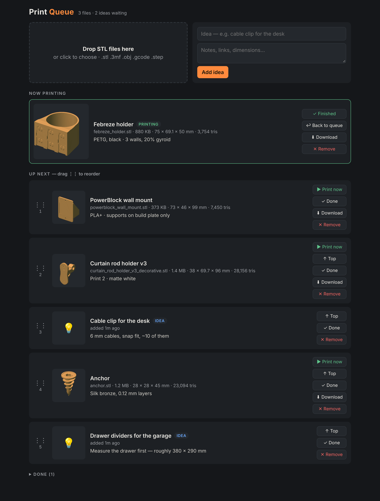
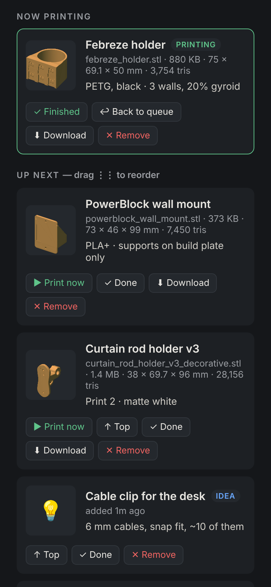
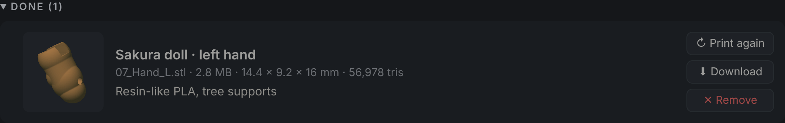

# 🖨️ 3D Printer Queue

**A tiny local web page for lining up 3D prints while your printer is busy.**

The printer's halfway through a 9-hour job and you've just finished the next model in Blender, or you're out in the garage and think *"I should print a cable clip for that"*. 3D Printer Queue gives those a place to go: drop in the STL or jot down the idea from your laptop or phone, and work through the list when the bed is clear.

No accounts, no cloud, no `pip install`. Just one Python file and one HTML page.

<p align="center">
  
</p>

---

## ✨ Features

| | |
|---|---|
| 📥 **Drag & drop uploads** | Drop STL, 3MF, OBJ, G-code or STEP files anywhere on the page. Upload progress included. |
| 💡 **Ideas, not just files** | Add "print this someday" ideas with notes, links and dimensions, all in the same queue. |
| 🧊 **Live 3D previews** | Every STL gets a shaded preview you can drag to spin. It's a hand-rolled canvas renderer, no Three.js. |
| 📏 **Size at a glance** | Bounding box in mm and triangle count, worked out on upload, so you know it'll fit on the plate. |
| ↕️ **Drag to reorder** | Grab the ⋮⋮ handle to shuffle priorities, or hit **↑ Top** to jump something to the front. |
| ▶️ **Now printing** | Mark the active job; it gets pinned at the top. Only one job prints at a time. |
| ✅ **Done history** | Finished prints collect in a collapsible Done list, ready to **↻ Print again**. |
| ✏️ **Inline editing** | Click any title or note to edit it in place. |
| 📱 **Phone-friendly** | Responsive layout, served on your LAN, and it syncs every 5 seconds across devices. |
| 🛟 **Nothing gets lost** | Removing an item moves its file to `data/removed/` rather than deleting it. |

## 🚀 Quick start

```bash
git clone https://github.com/mattwilsoncp/print-queue.git
cd print-queue
python3 app.py
```

```
3D Printer Queue running:  http://localhost:8765
From your phone:           http://192.168.1.42:8765
Ctrl+C to stop.
```

Open the first link on your computer, or the second on your phone (same Wi-Fi).

**Requirements:** Python 3.8+. That's it. Standard library only.

### Options

```bash
python3 app.py --port 9000          # use a different port
python3 app.py --host 127.0.0.1     # keep it on this computer only
```

## 🧭 How it works

<table>
<tr>
<td width="38%" valign="top">

</td>
<td valign="top">

**On your phone.** Same queue, same data. Add an idea from the garage, and it's on your laptop five seconds later.

**Finished prints** collect in a Done list at the bottom, ready to send back to the queue:



**Previews you can spin.** Drag any thumbnail to rotate the model. It's shaded with a tiny painter's-algorithm renderer in plain canvas, and huge meshes are sampled so it stays snappy.

</td>
</tr>
</table>

Each item moves through three states:

```
queued ──▶ printing ──▶ done
   ▲          │           │
   └──────────┴───────────┘   (back to queue / print again)
```

## 📂 Where your stuff lives

```
print-queue/
├── app.py              # the whole server (stdlib http.server)
├── static/index.html   # the whole UI (vanilla JS + CSS)
├── docs/               # README screenshots
└── data/               # created on first run, git-ignored
    ├── queue.json      # the queue itself, human-readable
    ├── uploads/        # your model files
    └── removed/        # files from removed items, just in case
```

`queue.json` is written atomically, so a crash mid-save won't corrupt it. Back up `data/` and you've backed up everything.

## 🔌 API

The page is a thin client over a small JSON API, so it's easy to script against:

| Method | Path | What it does |
|---|---|---|
| `GET` | `/api/queue` | List all items, in queue order |
| `POST` | `/api/upload` | Upload a file. Raw body, with headers `X-Filename` (required), `X-Title` and `X-Notes` (optional) |
| `POST` | `/api/idea` | `{"title": "...", "notes": "..."}` |
| `PATCH` | `/api/items/<id>` | Update `title`, `notes`, `material`, `color` or `status` (`queued` / `printing` / `done`) |
| `DELETE` | `/api/items/<id>` | Remove an item (its file is moved to `data/removed/`) |
| `POST` | `/api/reorder` | `{"ids": [...]}`, the full order |
| `GET` | `/files/<id>` | Download the item's file |

Queue a file straight from the terminal or a Blender export script:

```bash
curl -X POST http://localhost:8765/api/upload \
     -H "X-Filename: bracket.stl" -H "X-Notes: PETG, 3 walls" \
     --data-binary @bracket.stl
```

## 🗺️ Ideas for later

- [ ] Talk to the printer (Bambu / OctoPrint / Moonraker) for live progress and auto-finish
- [ ] Material & color tags with filters
- [ ] Estimated print time and filament from sliced G-code
- [ ] "Send to 3D Printer Queue" button straight from Blender

## ⚠️ A note on security

3D Printer Queue has no login. By default it listens on your whole local network so your phone can reach it, which is fine at home. Don't expose it to the internet. Use `--host 127.0.0.1` if you're on a network you don't trust.

---

<sub>Built for the workshop. Made with Python, a printer, and too many STLs.</sub>
